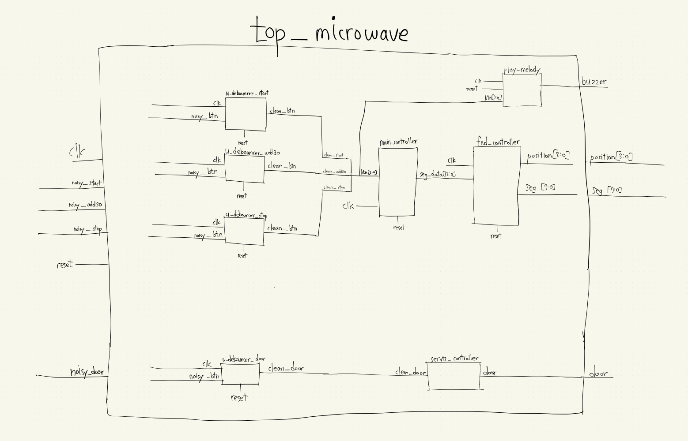
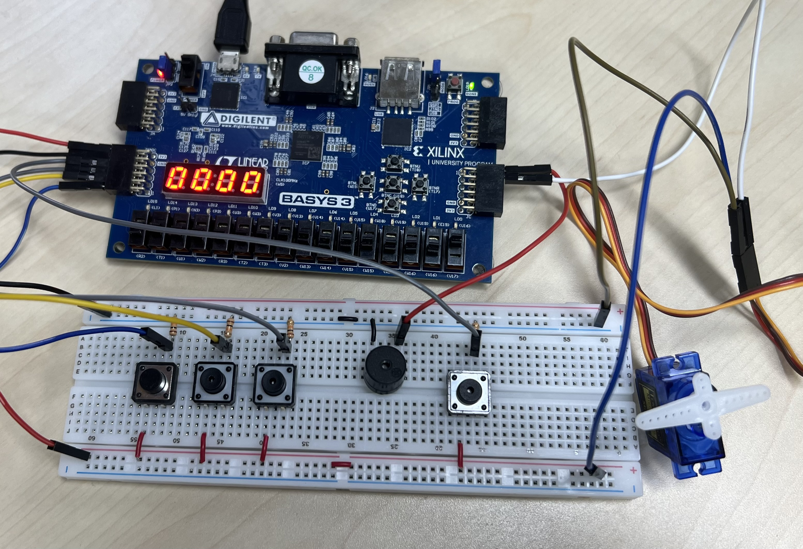

# FPGA 전자레인지 제어기

Verilog로 작성한 전자레인지 동작 모형입니다. 버튼으로 시간을 설정하고 카운트다운을 제어하며, 남은 시간을 4자리 7세그먼트에 표시합니다. 조리 종료 시 부저와 디스플레이로 알리고, 별도 버튼으로 서보 모터의 문 위치를 전환합니다.

## Function Block Diagram

직접 그린 기능 블록 다이어그램입니다.

## 실물 사진

## 주요 기능

- 시작 버튼: 설정된 시간이 있으면 카운트다운 시작
- 30초 추가 버튼: 남은 시간에 30초 추가 (최대 99분 59초)
- 정지 버튼: 카운트다운 정지
- 문 버튼: 서보 모터의 열림/닫힘 위치 전환
- 버튼 디바운싱, 버튼 입력음, 종료 멜로디 및 표시 깜빡임

## 부품 목록

| 부품 | 개수 | 용도 |
| --- | ---: | --- |
| Basys 3 FPGA 보드 | 1개 | 제어 로직 실행 및 100 MHz 클록 제공 |
| 4-Digit 7-Segment Display | 1개 | 남은 시간 표시 (Basys 3 내장) |
| Tactile Push Button Switch | 4개 | 시작, 30초 추가, 정지, 문 전환 입력 |
| Piezo Buzzer | 1개 | 버튼 입력음 및 조리 종료 알림 |
| Servo Motor | 1개 | 문 열림/닫힘 위치 제어 |

## 모듈 구성

| 파일 | 역할 |
| --- | --- |
| `src/top_microwave.v` | 최상위 모듈 및 각 모듈 연결 |
| `src/main_controller.v` | 시간 설정과 카운트다운 제어 |
| `src/button_debounce.v` | 버튼 입력 디바운싱 (`debouncer` 모듈) |
| `src/fnd_controller.v` | 남은 시간의 7세그먼트 표시 |
| `src/play_melody.v` | 버튼 입력음과 종료 알림 제어 |
| `src/servo_controller.v` | 서보 모터 PWM 제어 |

## 사용 방법

Vivado 등 Verilog 개발 도구에서 `src`의 파일 6개를 소스로 추가하고 `top_microwave`를 최상위 모듈로 지정합니다. 기본 설정은 100 MHz 클록과 Basys 3의 액티브 로우 7세그먼트를 기준으로 합니다. 실제 보드에서 사용하려면 보드에 맞는 핀 제약 파일(XDC)을 별도로 추가하세요.

## 트러블슈팅

### 1. 버튼을 한 번 눌렀는데 여러 번 입력되는 문제

- **문제와 원인:** 기계식 버튼의 접점이 짧은 시간 동안 여러 번 붙었다 떨어지는 채터링으로 인해 입력이 반복될 수 있습니다.
- **해결 과정:** `debouncer`에서 입력 상태가 충분히 안정적으로 유지된 뒤에만 `clean_btn`을 변경하도록 했습니다. 기본 100 MHz 클록에서 약 10 ms 동안 입력을 확인합니다.

### 2. 서보 모터 제어 신호가 불안정해질 수 있는 문제

- **문제와 원인:** PWM 주기 중간에 펄스 폭을 바꾸면 완전하지 않은 펄스가 발생해 서보 제어에 영향을 줄 수 있습니다.
- **해결 과정:** 문 버튼의 상승 에지에서 목표 위치를 전환하고, 실제 PWM 펄스 폭은 다음 프레임 경계에서 갱신하도록 했습니다. 또한 100 MHz 기준 클록 수 계산에 64비트 중간 연산을 사용해 오버플로를 방지했습니다.
