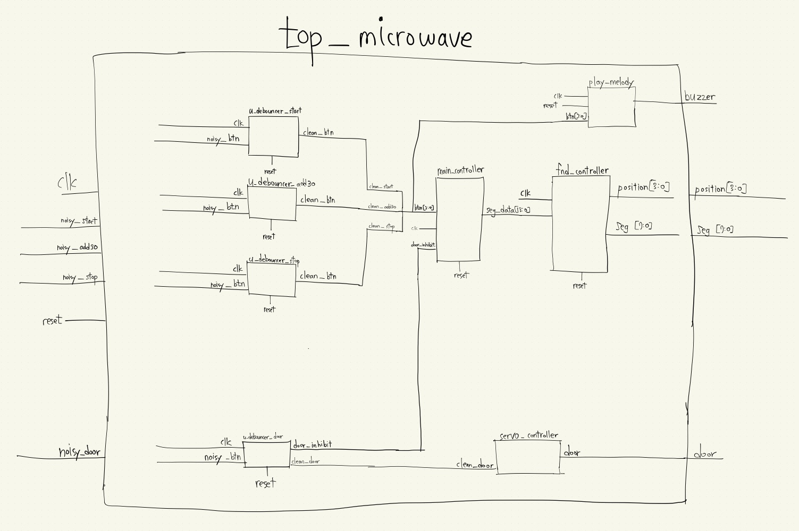
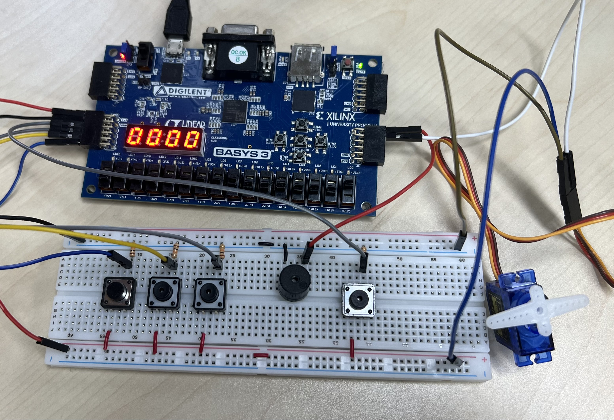
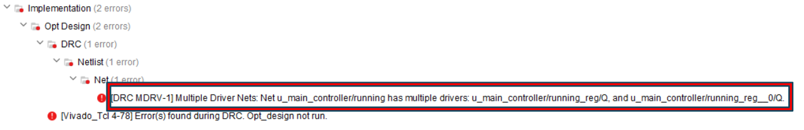

# FPGA 전자레인지 제어기

Verilog로 작성한 전자레인지 동작 모형입니다. 버튼으로 시간을 설정하고 카운트다운을 제어하며, 남은 시간을 4자리 7세그먼트에 표시합니다. 조리 종료 시 부저와 디스플레이로 알리고, 별도 버튼으로 서보 모터의 문 위치를 전환합니다.

## Function Block Diagram

직접 그린 기능 블록 다이어그램입니다.



## 실물 사진



## 주요 기능

- 시작 버튼: 설정된 시간이 있으면 카운트다운 시작
- 30초 추가 버튼: 남은 시간에 30초 추가 (최대 99분 59초)
- 정지 버튼: 카운트다운 정지
- 문 버튼: 서보 모터의 열림/닫힘 위치 전환
- 버튼 디바운싱, 버튼 입력음, 종료 멜로디 및 표시 깜빡임

## 부품 목록

| 부품 | 개수 | 용도 |
| --- | ---: | --- |
| Basys 3 FPGA 보드 | 1개 | 제어 로직 실행 및 100 MHz 클록 제공 |
| 4-Digit 7-Segment Display | 1개 | 남은 시간 표시 (Basys 3 내장) |
| Tactile Push Button Switch | 4개 | 시작, 30초 추가, 정지, 문 전환 입력 |
| Piezo Buzzer | 1개 | 버튼 입력음 및 조리 종료 알림 |
| Servo Motor | 1개 | 문 열림/닫힘 위치 제어 |

## 모듈 구성

| 파일 | 역할 |
| --- | --- |
| `src/top_microwave.v` | 최상위 모듈 및 각 모듈 연결 |
| `src/main_controller.v` | 시간 설정과 카운트다운 제어 |
| `src/button_debounce.v` | 버튼 입력 디바운싱 (`debouncer` 모듈) |
| `src/fnd_controller.v` | 남은 시간의 7세그먼트 표시 |
| `src/play_melody.v` | 버튼 입력음과 종료 알림 제어 |
| `src/servo_controller.v` | 서보 모터 PWM 제어 |

## 트러블슈팅

- **문제** — Vivado 합성 과정에서 하나의 신호를 여러 `always` 블록에서 제어하여 Multi-Driver 오류가 발생했습니다.

  

  *vivado 환경에서 출력된 오류 화면*

- **원인** — 동일한 레지스터에 복수의 순차 논리 블록이 값을 할당하면서 구동 충돌이 발생했습니다.

  ```verilog
  always @(posedge clk)
      if (door_inhibit) running <= 1'b0;

  always @(posedge clk)
      if (press[0]) running <= 1'b1;
  ```

- **해결** — `running` 제어 로직을 하나의 `always` 블록으로 통합했습니다. 정지 버튼을 우선 처리하고, 나머지 조건은 조리 완료, 문 열림, 시작 버튼 순으로 확인합니다.

  ```verilog
  if (second_tick && remaining_seconds == 1 && !press[1]) begin
      running <= 1'b0;
      timeout <= 1'b1;
  end else if (door_inhibit)
      running <= 1'b0;
  else if (press[0] && (remaining_seconds != 0 || press[1]))
      running <= 1'b1;
  ```

- **결과** — Multi-Driver 오류를 해결하고 `running` 신호의 제어 우선순위를 명확히 했습니다.
